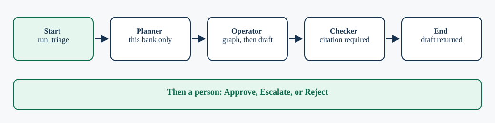
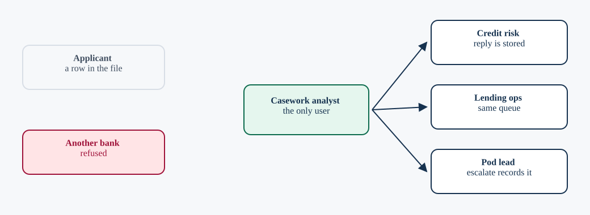
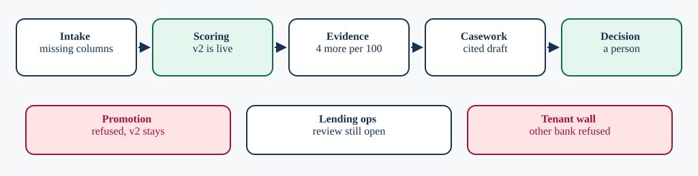

# Casework

Interview demo for DataRobot. Casework is a desk for one fictional bank, Emirates NBD Demo. The bank offers personal loans. Loan model v2 scores those applications today. Loan model v3 is the challenger and misses 4 more defaults per 100. The analyst decides whether v3 may score live applications.

The desk does not approve a person's loan, pay a loan, send a message, or change the live model. All data is synthetic. The signed in tenant is `tenant_demo_acme`.

## Quick start

    docker compose up --build

* Frontend: http://127.0.0.1:43123
* Backend: http://127.0.0.1:54123
* Sign in: `analyst` / `demo`

Sign in opens the brief at `/brief`. Open today's requests to reach the desk.

Without Docker, from the repo root:

    uvicorn backend.app:app --port 54123
    cd frontend && npm run dev

## What you click

1. Open **Hold the new loan model** (F-101). Draft the reply. The draft cites Loan model v3 and Loan model v2 on Personal loans, and it says do not promote.
2. Approve stores that reply for credit risk. Escalate records the case for the pod lead. Reject returns it to the analyst. Nothing is emailed, and Loan model v2 stays the model that scores loans.
3. Under Refusals, **Open tenant_other_corp** is refused as `cross_tenant` and written to the audit.
4. **Shut the model down in prod** is refused as `destructive_request` and written to the audit.

The queue is the seeded findings F-101 through F-109. There is no control that creates a new loan request. Application rows are in `data/application_book.json`. The live scorer is in `data/scoring_state.json`.

Token counts in the trace come from the OmniRoute response. They are not simulated.

## How this meets the assignment

The brief asks for a problem, a code first agent with a frontend and a backend, and a short talk: the problem, the solution, a live demo, the challenges, and how you would productize it for a DataRobot customer.

### The problem

The category is consumer lending. Emirates NBD Demo is a UAE bank that offers personal loans. They want loan model v3 to score those loans, and it misses 4 more defaults per 100 than the model already scoring applications. A consultant who only reads the title will miss that v2 is still scoring that same book of loans.

### The solution

The app is React and FastAPI, with a code first LangGraph loop: plan, read the graph, rank, draft, check. LangGraph keeps that path testable. The draft step asks OmniRoute for the reply. The graph answers which other model shares the use case. The checker requires a citation. The agent never deploys.

### The live demo

Open Hold the new loan model. Draft the reply. You should see v3 and v2 on Personal loans, a high priority, and a reply that says do not promote. Then approve it. Then refuse another customer, and refuse shutting the live model down.

### Challenges and learnings

A draft without a citation is rejected by the checker. A request for another tenant is refused and audited. The reply comes from the model through OmniRoute, and the trace shows that call's token count. The build is a working prototype, not a production system.

### The vision

A DataRobot customer in consumer lending has this decision every time a new credit model is ready. Productize the loop as a governed template: one bank, a graph of the models, a cited draft, a human decision, and an audit. Scale the template. Do not skip the person.

## Code first

The agent is a Python program. LangGraph compiles three functions, planner then operator then checker, from `agent/runner.py`. The state they share is the typed `TriageState` in that file: tenant, case, subgraph, rank, draft, and whether the planner refused. Tests call the same functions.

The same picture is stored as [frontend/src/diagrams/code-first.excalidraw](frontend/src/diagrams/code-first.excalidraw). Open that file in [Excalidraw](https://excalidraw.com) to edit it.

1. **Start.** Draft reply calls `run_triage` in `agent/runner.py` with this bank and the open case.
2. **Planner.** Checks the request is still inside Emirates NBD Demo. A cross tenant request stops here.
3. **Operator.** Reads the case from SQLite GraphRAG, ranks it, and asks OmniRoute for the reply. LangChain Core builds that prompt in code.
4. **Checker.** Rejects a draft that cites nothing in the graph.
5. **End.** The run returns the draft. Approve, Escalate, or Reject is a person, after the graph has finished.

## Who this serves

Casework serves the bank staff who have to decide whether a new credit model may score personal loans. Applicants are the subject of the file. They are not the audience of the reply.

Edit the source in [frontend/src/diagrams/who-this-serves.excalidraw](frontend/src/diagrams/who-this-serves.excalidraw).

### Credit risk

Who. The team inside the bank that owns loan model v2 and loan model v3. They need a hold or promote answer before v3 scores live applications.

How. They do not sign in. The analyst opens the case, the agent drafts a reply that cites both models, and Approve stores that reply for credit risk. Nothing is emailed, and the model that scores loans stays v2.

### Lending ops

Who. The team that owns the application file, the weekly credit review, and the open retrain note.

How. Their requests sit in the same queue. The draft names the missing columns and the review that still has no owner. A request to rescore production is refused.

### Casework analyst

Who. The person signed in on this desk. They are the only user of the product.

How. They pick a request, watch the agent plan, read the graph, and draft through OmniRoute, then Approve, Escalate, or Reject. The checker blocks a reply that cites nothing.

### Pod lead

Who. The analyst's lead, when a case should not be closed on the desk.

How. Escalate records the case for the pod lead. It does not send a message, and it does not contact an applicant.

### Applicant

Who. A person who asked the bank for a personal loan. They are a row in the bank's application file, not a user of Casework.

How. They apply at the bank, outside this product. This desk never shows them a decision and never pays a loan. The file is why the model choice and the missing columns matter.

### Another bank

Who. A second customer on the same platform. This desk is Emirates NBD Demo only.

How. Their findings stay in their own tenant. A request from this desk to read them is refused and written to the audit.

## The path

Applicants exist only as rows in the file. The reply is for credit risk or lending ops. Promotion does not change v2.

Edit the source in [frontend/src/diagrams/the-path.excalidraw](frontend/src/diagrams/the-path.excalidraw).

### Intake

Lending ops receives the application file. Missing income and loan amount opens that case. An empty file invents no rows.

### Scoring

Loan model v2 scores the book, including the west region. Nightly scoring has no owner.

### Evidence

The holdout fact stays 4 more defaults per 100. Debt to income left the file, and loan model v3 still expects it.

### Casework

The analyst opens the case. The agent plans, reads the graph, and drafts a reply through OmniRoute. The checker demands a real citation.

### Decision

Approve stores the reply for credit risk or lending ops. Escalate records it for the pod lead. Reject returns it to the analyst. Nothing is sent.

### Promotion

A request to put v3 live is refused. Promotion does not change v2. Loan model v2 stays the model that scores loans.

### Lending ops

The weekly credit review has no owner. The retrain note has not started. A production rescore is refused.

### Tenant wall

No pipeline reads another bank's book. A cross tenant request is refused and written to the audit.

## The tools

The tools this running desk uses, what each one does here, and why it is in the stack.

### React

How. The landing page, the sign in, this explanation, and the analyst desk are React 18 components.

Why. The assignment asks for a complete application a person can use, not a script that only prints a reply.

### Vite

How. Vite builds the React app for the frontend container and can serve it on port 43123 during development.

Why. The desk has to build cleanly into a static bundle the container can host.

### serve

How. The frontend image uses the serve package to host the built files on port 43123.

Why. The demo should open in a browser from one Compose stack, with no extra web server to install.

### AOS

How. The landing page uses AOS to fade sections in as you scroll. It stays off when the browser asks for reduced motion.

Why. The public page has to tell the lending story in order, without motion that fights the reader.

### Source Sans 3

How. Fontsource ships Source Sans 3 with the app for the reading text.

Why. The type stays inside the bundle, so the desk does not depend on a font service.

### JetBrains Mono

How. Fontsource ships JetBrains Mono for finding ids, payloads, and other fixed width text.

Why. Ids and payloads stay aligned and readable next to the prose.

### FastAPI

How. FastAPI serves the session, the request queue, the graph, the run, the scope check, the decision, and the audit.

Why. The agent needs one backend the desk can call, with the tenant bound on the server.

### Uvicorn

How. Uvicorn runs the FastAPI app on port 54123.

Why. The API has to stay up as its own process beside the frontend.

### Pydantic

How. FastAPI uses Pydantic to read JSON bodies before a route runs.

Why. A bad payload should fail at the door instead of halfway through a run.

### LangGraph

How. The triage run is a LangGraph graph: planner, then operator, then checker.

Why. The assignment asks for a code first agent. A fixed graph keeps that loop testable and visible on the desk.

### LangChain Core

How. LangGraph runs on LangChain Core. The project pins that library next to LangGraph.

Why. The agent loop needs that runtime to compile and invoke the graph.

### sse-starlette

How. After Draft reply, the desk opens a Server Sent Events stream at `/runs/{id}/events` and paints each step as it arrives.

Why. The analyst should see the plan, the graph read, the rank, the model call, and the check, not one silent wait.

### SQLite

How. SQLite holds the asset graph, the audit log, and human decisions under `backend/var`.

Why. One file is enough for the demo, and every row stays with its tenant. There is no separate database to operate.

### Docker Compose

How. Compose builds and runs the frontend on port 43123 and the backend on port 54123.

Why. The interview demo should start as one stack.

### OmniRoute

How. The draft step calls the local OmniRoute gateway at `/v1/chat/completions`. The model id is `gh/gpt-5.6-terra`. The trace shows the model name and the token count from that response. This repo does not change OmniRoute.

Why. The reply has to be written by a model. OmniRoute is the gateway already running here, so the agent does not keep provider keys of its own.

### pytest

How. pytest runs the scope refusals, the seeded lending story, the reply parser, and the page contracts.

Why. The guard and the story have to stay true when the desk changes.

### Playwright

How. Playwright opens the desk, signs in, drafts a reply, and checks the refusal path.

Why. The demo is a click path. A test that only calls the API would miss a broken button.

### OpenTelemetry

How. Each triage run opens an OpenTelemetry span named `casework.run`. The span carries the finding, the model, the token counts, and whether the checker passed. When `DATAROBOT_API_TOKEN`, `DATAROBOT_ENTITY_ID`, and a DataRobot endpoint are set, that span is sent to DataRobot.

Why. DataRobot external agent monitoring reads these spans. The run reports them now. Nothing is sent until those three values are set.

## Checks

    make eval        # 16 evals
    make test-all    # evals plus offline parser tests
    cd frontend && npm run build

`tests/sse_contract_regression.py` needs the backend running. `tests/browser_flow.py` needs the frontend and the backend running.

Storage is SQLite. There is no Postgres. `backend/var/` is gitignored. LightRAG and the security scanners are optional code. The running desk does not use them.

Agent notes: [CLAUDE.md](CLAUDE.md) and [AGENTS.md](AGENTS.md). The same brief is on the sign in path at `/brief`. The lending spec is [docs/superpowers/specs/2026-11-07-lending-usecase.md](docs/superpowers/specs/2026-11-07-lending-usecase.md).
