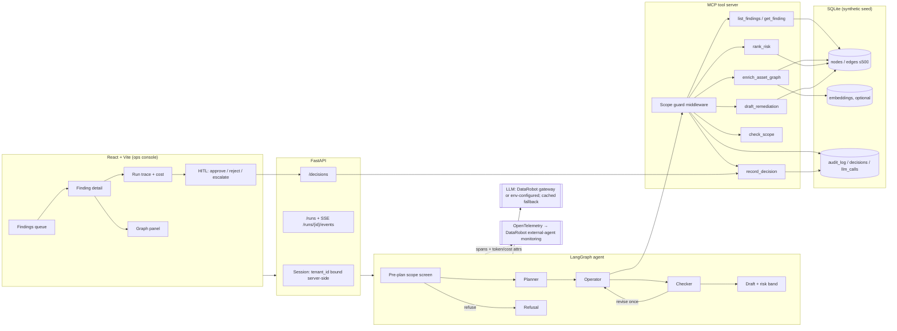
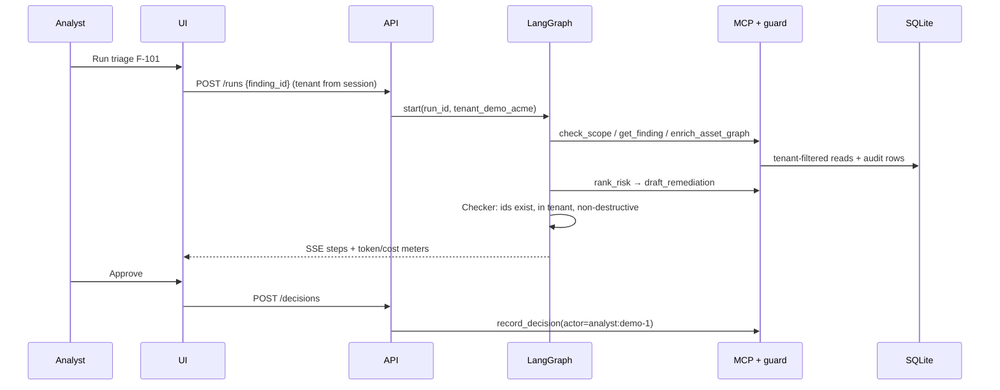

# Architecture: ThreatAI Security Analyst Agent (v1)

**Owner:** DR-AI-Eng · **Date:** 2026-11-05 (Asia/Dubai)  
**Covers:** PLAN §1b C4, B13 Technical Credibility, B15 Not production-ready  
**Related:** `agent_spec.md`, `docs/GRAPHRAG_ONTOLOGY.md`, `docs/SCOPE_GUARD.md`, `docs/PROMPT_CACHE.md`, `docs/MODEL_STRATEGY.md`, `evals/`

---

## 1. System view

## 2. Triage run sequence

## 3. Defended decisions (B13)

| Decision | Chosen | Alternatives considered | Why this choice | What would change it |
|----------|--------|-------------------------|-----------------|----------------------|
| Agent framework | **LangGraph**, planner → operator → checker | CrewAI, single ReAct loop, no-code builder | Explicit state machine: each edge can be unit-tested, checker can force one revision, refusals route to a terminal node. Code-first per brief. DataRobot agent templates support it | Need for multi-agent role-play (CrewAI) or a lighter-weight single tool loop |
| Knowledge layer | **GraphRAG** (k-hop subgraph + optional vectors) | Vector-only RAG; prompt-stuffing all findings | Exposure is relational: same segment, shared weakness, shared host, missing owner. Vector similarity misses "other cameras on this segment". Node ids give checkable citations | If findings stopped being relational, vector-only would be simpler |
| Graph store | **SQLite** nodes/edges + NetworkX traversal | Neo4j, a managed graph DB | One file, no extra service, fast cold start (E1 ≤60 s), runs in Docker and the DataRobot runtime. At ≤500 nodes, k-hop finishes in milliseconds | Graph >100k nodes, concurrent writers, or a customer-mandated graph DB → Neo4j behind the same `retrieve()` interface |
| Human control | **HITL is mandatory**: agent drafts, human decides via `record_decision` | Auto-remediate; auto-ticket | Regulated buyers need a named human approver and an audit trail. It also removes the agent's ability to cause harm | Never fully removed. Possible later: auto-file low-risk drafts to a review queue |
| Scope enforcement | **Deterministic middleware + check_scope tool + Checker** | Prompt-only rules | Prompts can be talked around, and middleware cannot. The tool makes scope visible in the trace. The Checker catches hallucinated ids | — |
| Tools | **MCP server** | In-process functions | Discoverable and reusable by other agents or IDEs. One chokepoint for the guard | In-process functions if MCP overhead hurts the latency bar |
| Risk scoring | **Deterministic factors in `rank_risk`**; LLM explains | LLM picks the band | Reproducible and evaluable against gold bands. Limits non-determinism | Fine-tuned ranker if evals plateau (MODEL_STRATEGY) |
| LLM | **DataRobot LLM Gateway** (placeholder Sonnet 4.5, to be confirmed) + recorded-run fallback | Self-hosted only | Fastest path to quality. Governed by DataRobot. Fallback keeps the demo alive offline | Cost or latency at scale → small-model candidates |
| Cost control | **Frozen prompt prefix + per-run token/cache/cost meters** | Ignore | Agent loops resend the same prefix several times per run. Caching plus meters make the cost measurable | — |
| Observability | **OpenTelemetry** spans → DataRobot external-agent monitoring | Custom logs only | Same signals PS customers would monitor in production. Stub exporter is fine for v1 | — |
| Packaging | **Docker Compose** (primary) + optional `dr run dev` | Kubernetes | One command for reviewers. `dr` path shows DataRobot alignment | Customer deployment → DataRobot app framework CI/CD |

## 4. Demo scope: what v1 is and is not (B15)

This is an **interview vertical slice**, not a production system. We state that plainly and make no hardening claims we have not earned.

What v1 is:
- One end-to-end triage path on **synthetic seed data**: `tenant_demo_acme`, F-101..F-107, plus eval-only findings. `tenant_other_corp` exists only for refusal tests.
- Real LangGraph loop, real scope middleware, real SQLite graph, real HITL persistence, real eval harness (`evals/`).
- LLM through a gateway when available. A **recorded/mocked LLM fallback** is allowed for dry runs and offline demos, and the UI labels it as such.

What v1 is not:
- Not multi-user auth. A demo tenant picker stands in for SSO/RBAC.
- Not connected to live ASM feeds, scanners, ticketing, or any customer data.
- Not load-tested, pen-tested, or HA. SQLite is single-node.
- No secrets management beyond `.env` and `.env.example`.
- The destructive-verb matcher is a rule list, not a complete safety classifier.

**Path to production** (see `docs/PRODUCTIZE.md` when written): SSO + RBAC per tenant, managed graph store, live finding ingestion connectors, DataRobot deployment + monitoring + guard models, red-team eval suite in CI, change-management integration behind HITL.

## 5. Suggested README "Demo scope" paragraph

> **Demo scope.** This repository is an interview vertical slice of a defensive security triage agent. All data is synthetic (`tenant_demo_acme`, findings F-101..F-107). A recorded LLM fallback is included for offline demos. It is not production-hardened: there is no SSO/RBAC, no live data connectors, and no load or security testing. See `docs/ARCHITECTURE.md` §4 for the production path.

## Data layer (locked)

Abdul chose **SQLite + Docker Compose** (no Postgres) for the interview vertical slice. Persist graph, decisions, audit_log, and llm_calls/run metrics in SQLite; ship with `docker compose up` as the primary local entrypoint.
