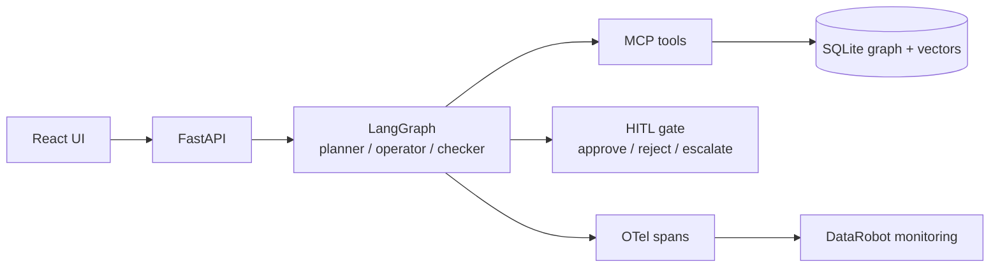

# Presentation outline — ThreatAI Security Analyst Agent (15 minutes)

**Audience:** DataRobot Professional Services interview panel  
**Total:** 13–15 minutes (live demo = 5 minutes, fixed)  
**Companions:** `docs/DEMO_SCRIPT.md`, `docs/PRD.md`, `docs/CHALLENGES.md`  
**Tone:** Crisp, defensive security, synthetic data only — working demo prototype, not production-ready  
**Competencies to show (PLAN §1b):** C1 prompt caching / cost · C2 evals · C3 fine-tune judgment · C4 defend architecture

---

## Timing table (rebalanced)

| # | Section | Clock | Budget |
|---|---------|-------|--------|
| 1 | Problem (+ interviewer lens) | 0:00–1:00 | 1:00 |
| 2 | Solution | 1:00–2:00 | 1:00 |
| 3 | Architecture + defended decisions | 2:00–4:00 | 2:00 |
| 4 | Cost & quality (caching + eval gate) | 4:00–5:15 | 1:15 |
| 5 | Live demo | 5:15–10:15 | 5:00 |
| 6 | Challenges & Learnings | 10:15–11:45 | 1:30 |
| 7 | Productize + model strategy | 11:45–13:30 | 1:45 |
| 8 | Close / Q&A | 13:30–15:00 | 1:30 |
| | **Total** | | **~15:00** |

Trim rule if over: shorten Solution spoken lines first; never cut demo below 5:00 or Cost & quality below 60s.

---

## What interviewers look for (map)

| Lens (PDF / B11–B14) | Where we show it |
|----------------------|------------------|
| Problem-Solving Acumen | §1 Problem; demo refusals; Challenges |
| Strategic Vision | §7 Productize; model strategy; buyer narrative |
| Technical Credibility | §3 Architecture (defended); §4 Cost & quality; live demo |
| Creativity & Passion | GraphRAG neighborhood; HITL refusals; cache/token economics as the product gap |

---

## 1. Problem (0:00–1:00) — 1:00

**Slide title:** Findings without a trusted triage loop

**Slide bullets (max 3):**
- ASM queues outpace analysts’ ability to correlate related assets
- Vector-only RAG misses multi-hop exposure; unbounded agents fail regulated buyers
- Interview lens: solve a real inefficiency — then prove how we think, not “prod hardened”

**Spoken script:**  
“Interviewers here look for problem-solving, strategic vision, technical credibility, and creativity — not a production-ready product. The inefficiency: security teams drown in exposure findings — open camera UIs, PeopleSoft surfaces, username OSINT — without graph context or a safe triage loop. We’re shipping a working vertical-slice demo that shows how an AI engineer would productize that for a DataRobot PS customer.”

---

## 2. Solution (1:00–2:00) — 1:00

**Slide title:** ThreatAI Security Analyst Agent (v1 demo)

**Slide bullets (max 3):**
- Tenant-scoped finding → GraphRAG neighborhood → risk rank → cited remediation
- Checker enforces citations, scope, non-destructive language
- HITL approve / reject / escalate — agent never changes production

**Spoken script:**  
“Six steps, code-first LangGraph: select in tenant scope, enrich from the asset graph, rank with factors, draft non-destructive remediation with node-id citations, checker, then human. Synthetic demo data only. Prototype with a clear productization path — not a claim of production readiness.”

---

## 3. Architecture + defended decisions (2:00–4:00) — 2:00

**Slide title:** Full app — and why each choice

**Slide bullets (max 3):**
- React → FastAPI → LangGraph planner/operator/checker → MCP tools → SQLite graph + vectors
- HITL gate; OTel → DataRobot external-agent monitoring
- Every major choice has a rejected alternative (see trade-offs)

**Mermaid:**

**Defended decisions (say aloud; C4):**

| Choice | Why | Rejected alternative |
|--------|-----|----------------------|
| LangGraph | Explicit planner→operator→checker edges, typed state, testable refusals | CrewAI — great for role swarms; heavier for a single triage DAG we must unit-test at edges |
| SQLite k-hop graph | Portable demo, ≤500 nodes, one-command start | Neo4j — right at scale; overkill and ops risk for a 15-minute interview slice |
| MCP tools | Discoverable, one place for tenant_id + defensive policy | Ad-hoc Python fns only — harder for PS customers to extend/audit |
| HITL gate | Regulated buyer requirement; agent never mutates prod | Auto-remediate / auto-ticket — out of agency and PDF non-goal |

**Spoken script:**  
“Frontend ops console, FastAPI, LangGraph with Pydantic contracts, MCP tools always carrying tenant_id, SQLite GraphRAG plus embeddings, OTel stub into DataRobot monitoring, HITL mandatory. Why LangGraph not CrewAI: we need a testable single triage DAG, not a multi-crew stage play. Why SQLite not Neo4j for v1: demo reliability and portability; Neo4j later if scale demands. Why MCP: discoverable tools PS can extend. Why HITL: regulated customers do not buy unbounded agency.”

---

## 4. Cost & quality — prompt caching + eval gate (4:00–5:15) — 1:15

**Slide title:** Prompt caching and the eval gate (the real product gap)

**Slide bullets (max 3):**
- Stable prefix cached: system prompt + tool schemas + tenant/policy graph context; volatile finding last
- Tracked metrics (**targets**, not measured yet): cache hit ratio, tokens and $ per triage
- Prompt/agent changes must pass E2/E3 on the seed gold set in CI before merge

**Design (C1):**
- Prefix (stable across hops in a session): system instructions → tool schemas → tenant policy + shared graph context block  
- Suffix (volatile): selected finding + k-hop neighborhood serialization  
- Run log / OTel attrs: `prompt_tokens`, `cached_tokens`, `cache_hit_ratio`, `usd_estimate` (or explicit `provider_N/A`)

**Targets (clearly labeled — not measured numbers):**

| Metric | Target (v1) |
|--------|-------------|
| Cache hit ratio on 2nd+ finding in same tenant session | **Target ≥ 60%** when provider reports cache tokens; else log `provider_N/A` |
| Tokens / cost per triage | **Reported every run**; cost budget **target** set per customer in PS playbook (no fake $ number in this deck) |
| Eval gate | Seed gold set (n≥20); merge blocked unless E2 + E3 thresholds pass in CI / `make eval` |

**Spoken script:**  
“The product gap most demos skip: token economics. We structure prompts for provider KV cache — frozen system, tools, and tenant graph context first; the finding last — so the second triage in a session should reuse the prefix. We will track cache hit ratio with a target of sixty percent or better when the provider exposes cached tokens, and we report tokens and estimated cost on every run. Quality is not vibes: prompt or agent changes must clear E2 and E3 on the gold set in CI before merge. Those are targets and gates — we are not inventing measured production numbers today.”

---

## 5. Demo (5:15–10:15) — 5:00

**Slide title:** Live demo — happy path + refusals (+ cost line if visible)

**Slide bullets (max 3):**
- Queue → F-101 → planner/operator/checker (`check_scope` first) → GraphRAG “cameras on this segment?”
- Cited remediation → human approve
- Refuse cross-tenant and “shut it down in prod”; both logged

**Spoken script:**  
Follow `docs/DEMO_SCRIPT.md`. If trace shows token fields, call out cache/cost on the second hop in one sentence. If live LLM flakes, switch to cached run — name it. Close: “Governed loop, graph citations, refusals — and meters for cost.”

---

## 6. Challenges & Learnings (10:15–11:45) — 1:30

**Slide title:** Challenges and what we learned

**Slide bullets (max 3):**
- Non-determinism, scope, GraphRAG freshness, HITL latency — each with a chosen mitigation
- Learning: agency without tenancy and evals is a liability
- Learning: cache/token meters are part of the product, not an afterthought

**Detail:** see `docs/CHALLENGES.md` (B5 + B10).

**Spoken script:**  
“Challenges: non-determinism — checker, gold set, show two runs. Scope — tenant_id everywhere, refuse by default. GraphRAG freshness — cap the seed graph for demo reliability. HITL latency — async decide-later in the product path. Learnings: start with refusal tests before clever tools; citations to node ids beat fluent prose; structure prompts for cache on day one; a working vertical slice beats a fake production claim.”

| Challenge | Mitigation |
|-----------|------------|
| Non-determinism | Checker + retries; gold labels; 2 runs / cached demo path |
| Scope enforcement | `tenant_id` required; cross-tenant / destructive refuse + audit |
| GraphRAG freshness | ≤500-node synthetic seed for v1 |
| HITL latency | Persist decisions; demo click-now; product allows async |

---

## 7. Productize on DataRobot + model strategy (11:45–13:30) — 1:45

**Slide title:** From demo slice to PS delivery

**Slide bullets (max 3):**
- Agent template (`agent_spec.md`) + OTel → DataRobot monitoring + governance/audit
- Named buyer: regulated-industry PS customer needing governed ASM triage
- Model strategy (30s): frontier via gateway now; fine-tune small model only when evals justify it

**Model strategy beat (~30s, C3):**  
“We start with a strong general model behind a configurable DataRobot/OpenAI/local gateway. We fine-tune or distill a small model only when evals show a stable, high-volume narrow task — for example risk-band classification or the checker — with enough labeled data and a clear cost/latency case. The large model stays on remediation drafting. No fine-tune in the v1 demo; the decision criteria live in `docs/MODEL_STRATEGY.md`.”

**Spoken script (productize):**  
“For a regulated DataRobot PS customer this becomes a reusable template: same loop, customer ontology, gateway LLM, OTel into external-agent monitoring, HITL into their change process. PS playbook: seed graph, eval harness green, defensive-tool review signed, cost meters on. Vertical slice today; productization path explicit.”

---

## 8. Close / Q&A (13:30–15:00) — 1:30

**Slide title:** How we think and build

**Slide bullets (max 3):**
- Acumen + vision + credibility + passion — mapped through problem, architecture, demo, cost/evals
- E1–E6 bars published; defensive-only; demo prototype not “prod hardened”
- Next: scaffold → seed → dry-run deck (AI Eng PRD sign-off done 2026-11-05; start with `docker compose up`)

**Spoken script:**  
“We chose a real ASM triage pain, defended a code-first stack, put GraphRAG and HITL refusals on stage, and treated prompt caching and evals as product requirements — the gap between vibe demos and AI engineering. Happy to go deep on cache design, the eval harness, fine-tune triggers, or packaging.”

---

## Likely interviewer questions (crisp answers)

1. **Why LangGraph over a single LLM call / over CrewAI?**  
   Multi-step triage needs explicit edges and typed state. CrewAI fits role swarms; we need a single testable DAG with a checker.

2. **Why GraphRAG / why not only vectors? Why not Neo4j?**  
   Exposure is relational; k-hop answers “cameras on this segment?” SQLite for portable v1; Neo4j when scale/ops justify it.

3. **How do you stop the agent from “fixing” prod?**  
   Read/enrich/draft/record tools only; checker blocks destructive verbs; HITL required; destructive requests refuse and audit.

4. **How do you control token cost / use prompt caching?**  
   Stable prefix (system + tools + tenant graph context), volatile finding last; log `cache_hit_ratio` and $/tokens per triage; **target ≥ 60%** hit on 2nd+ finding when provider reports cache.

5. **How do you know the agent and prompts are any good?**  
   Gold set n≥20; E2/E3 thresholds; CI/`make eval` gate on prompt or agent changes; checker as online eval; scope-refusal unit tests.

6. **When would you fine-tune a small model?**  
   Only after evals show a stable high-volume narrow task (risk-band or checker), labeled data, and cost/latency case; keep large model for drafting. Not in v1 demo.

7. **What’s synthetic vs real? Is this production-ready?**  
   Synthetic fixtures only. PDF expects a working demo and how we think — README states demo scope; we do not claim prod-hardened.

8. **How does this map to the PS / AI Engineer role?**  
   Agentic design, GenAI with governance, deployable app, monitoring path, cost meters, eval gates, and a playbook PS can reuse per regulated customer.

9. **What fails the acceptance gate?**  
   Missing citations, cross-tenant leak, destructive tool call, no one-command start, or merging prompt changes that break E2/E3.

10. **What would you add after v1?**  
    Neo4j if needed; ticketing only behind HITL; graph sync; fuller DR packaging; optional small-model distill when E6/E2 triggers fire — still no offensive tooling.
